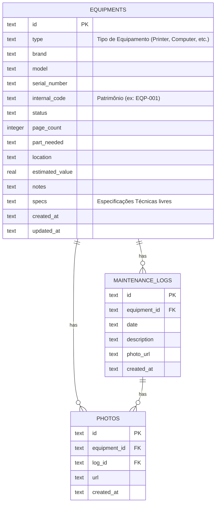

# Especificação Técnica: Transição para Controle de Equipamentos de TI

**Data:** 24 de Julho de 2026  
**Status:** Aprovado  

---

## 1. Descrição do Objetivo

Evolver a aplicação "Printer Tracker" para um sistema abrangente de inventário e controle de manutenção de equipamentos de TI corporativos (computadores, notebooks, impressoras, etiquetadoras, ativos de rede, etc.). O sistema unificará o controle patrimonial utilizando identificadores sequenciais baseados no prefixo unificado `EQP-` e permitirá cadastrar especificações técnicas customizadas em um formato de campo livre.

---

## 2. Arquitetura e Modelagem do Banco de Dados

Substituiremos a tabela de impressoras por uma tabela geral de equipamentos e migraremos os dados existentes sem perdas.

### Script de Migração Automática (db.js)
No arranque da aplicação backend, se a tabela `printers` for detectada, o banco executará em uma transação única:
1. Criar a tabela `equipments`.
2. Mapear e copiar os dados existentes de `printers` para `equipments`, configurando `type = 'Printer'`.
3. Criar a nova tabela `maintenance_logs` referenciando `equipment_id` e migrar os logs originais.
4. Criar a nova tabela `photos` referenciando `equipment_id` e migrar as fotos.
5. Remover as tabelas antigas.

---

## 3. Endpoints da API e Retrocompatibilidade

A API responderá oficialmente em `/api/equipments` e proverá aliases transparentes nas rotas antigas `/api/printers` para evitar que versões instaladas do app mobile quebrem durante a transição.

### Lista de Endpoints
- `GET /api/equipments` — Filtros por `status`, `type` e termo `q`.
- `POST /api/equipments` — Salvar novo equipamento.
- `GET /api/equipments/:id` — Obter dados e fotos.
- `PUT /api/equipments/:id` — Atualizar atributos.
- `DELETE /api/equipments/:id` — Remover equipamento.
- `GET /api/equipments/:id/logs` — Listar manutenção.
- `POST /api/equipments/:id/logs` — Criar entrada de manutenção.

---

## 4. Interface do Usuário (Mobile & Web)

### Mapeamento de Tipos de Equipamentos e Ícones
- `Printer` (Impressora): 🖨️
- `Computer` (Computador): 🖥️
- `Notebook` (Notebook): 💻
- `Label Maker` (Etiquetadora): 🏷️
- `Network` (Equipamento de Rede): 🌐
- `Other` (Outros): 📦

### Aplicativo Mobile (React Native)
- Renomeação da estrutura física de roteamento do expo-router de `app/printer/` para `app/equipment/`.
- Tela principal (`app/index.tsx`):
  - Título alterado para "Equipamentos de TI".
  - Adicionado dropdown/chips de filtro por Tipo de Equipamento.
  - Ícone de tipo renderizado ao lado do nome do equipamento no card.
- Formulários (`new.tsx` e `[id].tsx`):
  - Inclusão do dropdown de seleção de Tipo.
  - Inclusão de campo de entrada multilinha "Especificações Técnicas" (ex: CPU, RAM, HD/SSD para computadores, ou tipo de fita/toner para etiquetadoras/impressoras).

### Painel Web (`public/index.html`)
- Painel rebatizado para "Controle de Equipamentos de TI".
- Adicionadas colunas na tabela de listagem para "Tipo" e "Especificações".
- Adicionado filtro dropdown para selecionar tipos específicos na barra de controles superior.
- Função de exportação para Excel (.xls) atualizada para incluir os novos campos.
